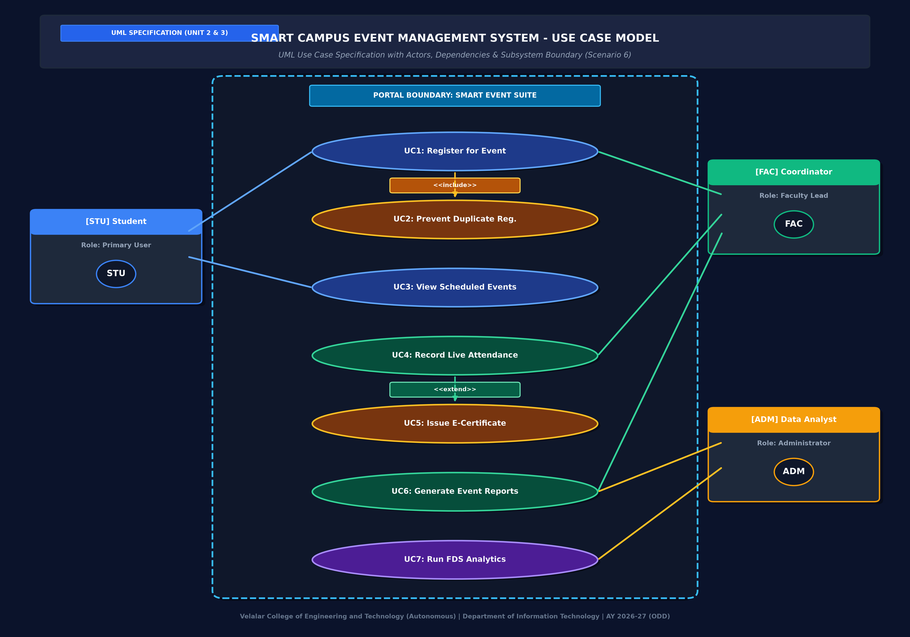
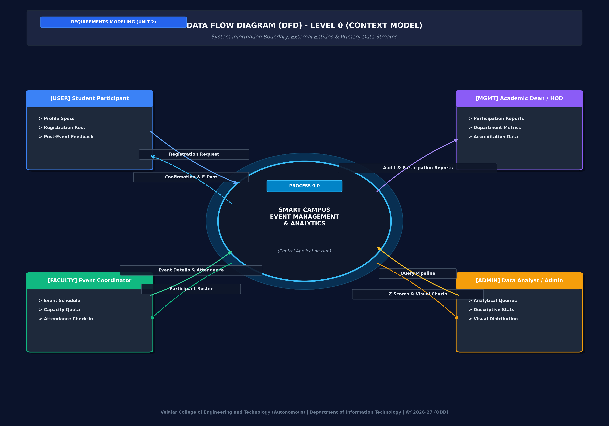
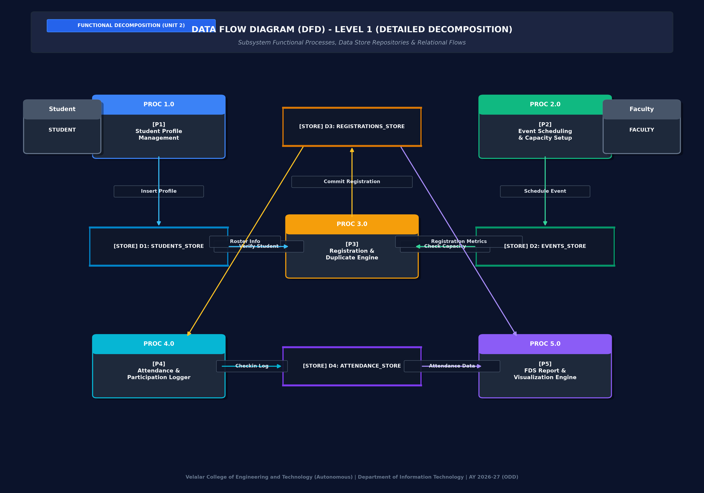
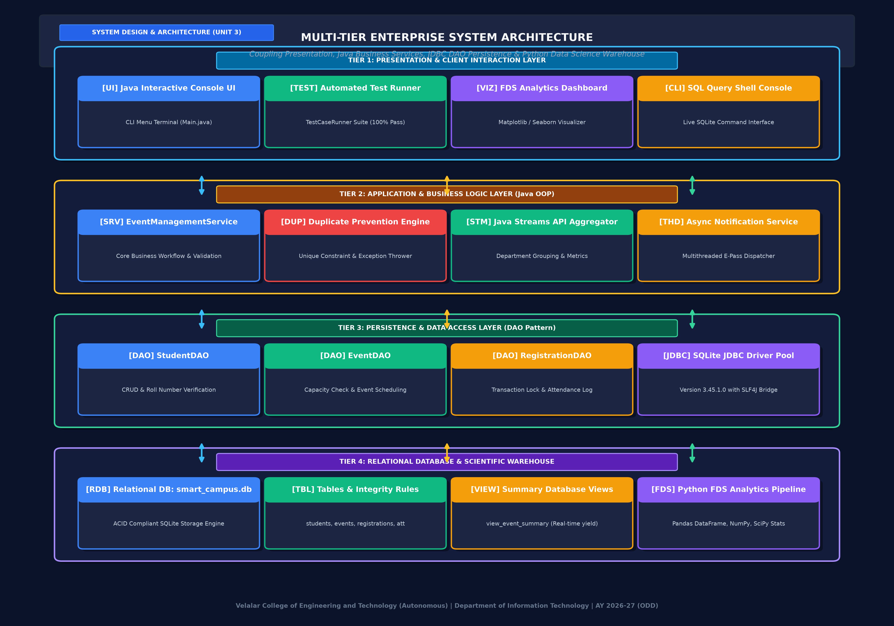
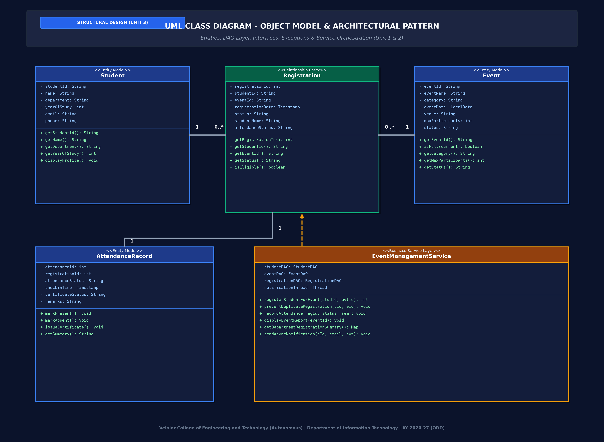
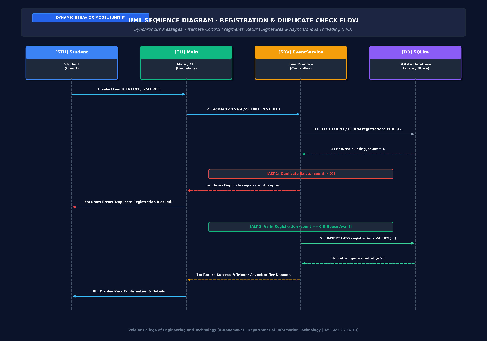
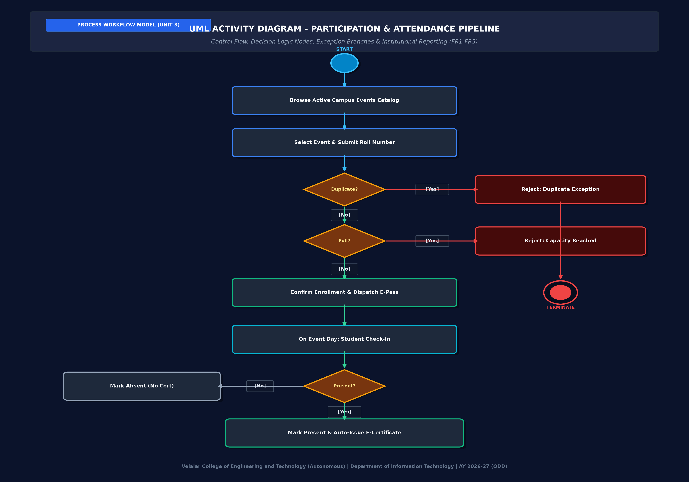

# SOFTWARE REQUIREMENTS SPECIFICATION (SRS)
## IEEE Std 830-1998 Standard Compliant
---
# SMART CAMPUS EVENT MANAGEMENT AND STUDENT PARTICIPATION ANALYSIS SYSTEM
### SCENARIO 6 (Register Nos.: 25IT006, 25IT036, 25IT066, 25IT096)
---
### VELALAR COLLEGE OF ENGINEERING AND TECHNOLOGY (AUTONOMOUS)
### (Approved by AICTE, Affiliated to Anna University, NAAC 'A+' Grade, NBA Accredited)
### Department of Information Technology | Academic Year: 2026 - 2027 (ODD) | Class: 25IT3A&B
### Course: 25ITT33 - Software Engineering

---

## TABLE OF CONTENTS
1. [Introduction](#1-introduction)
   * 1.1 Purpose
   * 1.2 Document Conventions
   * 1.3 Intended Audience and Reading Suggestions
   * 1.4 Project Scope
   * 1.5 References
2. [Overall Description](#2-overall-description)
   * 2.1 Product Perspective
   * 2.2 Product Functions
   * 2.3 User Classes and Characteristics
   * 2.4 Operating Environment
   * 2.5 Design and Implementation Constraints
   * 2.6 User Documentation
   * 2.7 Assumptions and Dependencies
3. [Software Process Model & Project Management](#3-software-process-model--project-management)
   * 3.1 Agile Process Model Justification
   * 3.2 4P's Management Framework (People, Product, Process, Project)
   * 3.3 Project Estimation: COCOMO & Function Point Analysis
   * 3.4 Risk Management & Mitigation
4. [System Architecture & Design Diagrams (7 Types)](#4-system-architecture--design-diagrams)
   * 4.1 UML Use Case Diagram
   * 4.2 Data Flow Diagram (DFD Level 0 - Context Level)
   * 4.3 Data Flow Diagram (DFD Level 1 - Detailed Decomposition)
   * 4.4 Multi-Tier System Architecture Diagram
   * 4.5 UML Class Diagram (Structural Design)
   * 4.6 UML Sequence Diagram (Dynamic Event Registration Flow)
   * 4.7 UML Activity Diagram (Participation Lifecycle)
5. [System Features & Specific Functional Requirements](#5-system-features--specific-functional-requirements)
   * 5.1 FR1: Maintain Student Details
   * 5.2 FR2: Add and Manage Event Details & Capacity
   * 5.3 FR3: Event Registration & Duplicate Prevention
   * 5.4 FR4: Record Attendance & Certification Status
   * 5.5 FR5: Display Participants & Generate Event-Wise Reports
   * 5.6 FR6: Data Retrieval, Preprocessing & Visualization (FDS)
6. [Non-Functional Requirements (NFRs)](#6-non-functional-requirements)
   * 6.1 Performance Requirements
   * 6.2 Safety & Security Requirements
   * 6.3 Software Quality Attributes
   * 6.4 Verification and Validation (V&V) Standards

---

## 1. INTRODUCTION

### 1.1 Purpose
The purpose of this Software Requirements Specification (SRS) document is to provide a complete, rigorous, and formal description of the **Smart Campus Event Management and Student Participation Analysis System**. It details both the functional capabilities and non-functional performance constraints required by Velalar College of Engineering and Technology (VCET) to transition from error-prone manual spreadsheets to an integrated, automated event administration and data science platform.

### 1.2 Document Conventions
This specification conforms to the IEEE Std 830-1998 format.
* **MANDATORY**: Critical system obligations that must be verified during system testing.
* **FR**: Functional Requirement identifier.
* **NFR**: Non-Functional Requirement identifier.

### 1.3 Intended Audience
* **Software Development Team (Java/Python Engineers)**: System implementation and unit testing.
* **Database Administrators (DBAs)**: Schema generation, integrity enforcement, and query optimization.
* **Department Academic Auditors & Faculty Coordinators**: Event scheduling, verification of attendance rosters, and student engagement validation.
* **Data Analysts & Administrative Leadership (HOD, Dean)**: Extracting behavioral participation patterns and curriculum enrichment insights.

### 1.4 Project Scope
The Smart Campus Event Management System automates student profile maintenance, event scheduling, seat capacity allocation, duplicate registration rejection, on-day attendance logging, e-certificate eligibility tracking, and multi-variable predictive data science analytics. It provides a multi-tier solution integrating a Java application, SQLite relational database, and Python analytics dashboard.

### 1.5 References
1. IEEE Std 830-1998: *Recommended Practice for Software Requirements Specifications*.
2. Roger S. Pressman & Bruce R. Maxim: *Software Engineering: A Practitioner's Approach*, 9th Edition, McGraw-Hill, 2020.
3. Ian Sommerville: *Software Engineering*, 10th Edition, Pearson, 2023.
4. VCET Autonomous Curriculum & Syllabi: 25ITT33 (SE), 25ITT31 (DBMS), 25ITT32 (Java), 25ITC31 (FDS).

---

## 2. OVERALL DESCRIPTION

### 2.1 Product Perspective
The system functions as a self-contained Smart Campus Academic Ecosystem module, operating across a three-tier architecture:
1. **Front-End / UI Layer:** Java CLI and Graphical Dashboards.
2. **Business & Persistence Layer:** Java JDBC Service Layer and SQLite Database.
3. **Analytical & Visualization Layer:** Python Foundations of Data Science (Pandas, NumPy, Seaborn, Matplotlib).

### 2.2 Product Functions
* Student identification, academic profile cataloging, and department assignment.
* Event publishing with category categorization, room/hall assignment, and seat quotas.
* Transactional registration with automatic uniqueness validation to eliminate double-booking.
* Real-time attendance logging and e-certificate distribution.
* Automated report generation and department-wide statistical trend modeling.

### 2.3 User Classes and Characteristics
* **Student User:** Enrolls in events, inspects event status, verifies attendance, receives e-passes.
* **Event Coordinator (Faculty):** Creates event briefs, establishes maximum participant capacity, records physical attendance, prints participant rosters.
* **Department HOD / Academic Dean:** Reviews cross-departmental engagement metrics, evaluates student co-curricular activities, optimizes event schedules.
* **Data Analyst / Administrator:** Executes data cleaning, computes participation $z$-scores, generates institutional visualizations.

---

## 3. SOFTWARE PROCESS MODEL & PROJECT MANAGEMENT

### 3.1 Agile Process Model Justification
In accordance with **Unit 1 (Software Process)**, the development employs the **Agile Scrum Methodology** for the following reasons:
* Rapid two-week iterative sprints aligning with academic semester milestones.
* Early incremental delivery: The core database and registration engine were validated before layering the Python analytics pipeline.
* Continuous stakeholder feedback from VCET event coordinators and students.

### 3.2 4P's Management Framework (Unit 5)
* **People:** Cross-functional 4-student team (Register Nos. 25IT006, 25IT036, 25IT066, 25IT096) structured into Database Lead, Java Developer, FDS Analyst, and Quality Assurance/SE Lead.
* **Product:** A scalable campus event lifecycle automation and visualization platform.
* **Process:** Agile Scrum with daily standups, sprint reviews, and Git repository integration.
* **Project:** Time-boxed project plan executed across the 2026-27 Odd Semester.

### 3.3 Project Estimation: COCOMO & Function Point Analysis
* **Lines of Code (LOC):** $\approx 1,800$ LOC across Java, SQL, and Python modules.
* **Function Point (FP) Count:** Calculated based on 5 External Inputs, 4 External Outputs, 5 Internal Logical Files, and 3 External Inquiries $\approx 68$ Unadjusted Function Points.
* **COCOMO Effort:** Organic mode: $\text{Effort} = 2.4 \times (1.8)^{1.05} \approx 4.5$ Person-Months.

---

## 4. SYSTEM ARCHITECTURE & DESIGN DIAGRAMS (7 TYPES)

### 4.1 UML Use Case Diagram
Visualizes the primary actors (Student, Event Coordinator, Data Analyst) and their interactions with system functional use cases, including `<<include>>` and `<<extend>>` dependencies.

---

### 4.2 Data Flow Diagram (DFD Level 0 - Context Level)
Illustrates high-level entity interactions and system information boundaries.

---

### 4.3 Data Flow Diagram (DFD Level 1 - Detailed Decomposition)
Decomposes the core system into 5 discrete sub-processes (1.0 Student Profile, 2.0 Event Scheduling, 3.0 Registration & Duplicate Check, 4.0 Attendance Tracking, 5.0 Report & Analytics) and their interaction with 4 database data stores.

---

### 4.4 Multi-Tier System Architecture Diagram
Defines the technical multi-tier architecture spanning Presentation, Java Application Logic, Persistence / DAO, and SQLite / Python Analytics Layers.

---

### 4.5 UML Class Diagram (Structural Design)
Details object-oriented entities, attributes, visibility, operations, and relationships using model-view-controller / DAO architectural patterns.

---

### 4.6 UML Sequence Diagram (Dynamic Event Registration Flow)
Models the dynamic message sequence during student event registration, detailing database uniqueness verification, exception handling, and asynchronous notification dispatch.

---

### 4.7 UML Activity Diagram (Participation Lifecycle)
Captures the operational workflow from event browsing through duplicate/capacity evaluation, check-in attendance, and data warehouse analytics update.

---

## 5. SYSTEM FEATURES & SPECIFIC FUNCTIONAL REQUIREMENTS

### 5.1 FR1: Maintain Student Details
* **Description:** Maintain student profiles including student ID, name, department, year of study (1 to 4), institutional email, and mobile number.
* **Input:** Student identification fields.
* **Output:** Validated persistent record stored in the `students` table.
* **Validation:** Email pattern regex verification and unique key enforcement.

### 5.2 FR2: Add and Manage Event Details & Capacity
* **Description:** Enable coordinators to publish events with event ID, title, category, date, venue, organizer department, and maximum participant count.
* **Input:** Event specifications.
* **Output:** Scheduled event available in the campus catalogue.
* **Validation:** $max\_participants > 0$; date must not be in the past for new events.

### 5.3 FR3: Event Registration & Duplicate Prevention (CRITICAL REQUIREMENT)
* **Description:** Permit registered students to enroll in upcoming events. Strictly prevent duplicate enrollments for the same student-event pairing.
* **Input:** `student_id`, `event_id`.
* **Output:** Generated unique `registration_id`, confirmation status, and asynchronous e-pass generation.
* **Exception Handling:** If `isAlreadyRegistered(studentId, eventId) == true`, throw `DuplicateRegistrationException` and reject the transaction.
* **Capacity Handling:** If `current_registrations >= max_participants`, throw `EventCapacityExceededException`.

### 5.4 FR4: Record Student Attendance & Participation Status
* **Description:** On event day, record whether registered candidates are `Present` or `Absent`, timestamp check-in times, and update e-certificate eligibility status to `Issued` or `Not Eligible`.
* **Input:** `registration_id`, `attendance_status`, `remarks`.
* **Output:** Updated attendance log.

### 5.5 FR5: Display Participants & Generate Event-Wise Reports
* **Description:** Generate comprehensive event-wise summaries showing participant names, roll numbers, departments, attendance percentage, and capacity utilization using Java Streams API.
* **Output:** Formatted tabular console and exportable reports.

### 5.6 FR6: Retrieve Data, Preprocess & Visualize (FDS)
* **Description:** Ingest dataset from SQLite into Python Pandas DataFrames, clean missing attributes, calculate $z$-score statistics, compute department-event pivot tables, and generate publication-quality Matplotlib/Seaborn visualizations.

---

## 6. NON-FUNCTIONAL REQUIREMENTS (NFRs)

### 6.1 Performance Requirements
* **Response Latency:** Event registration and duplicate validation queries must complete within $< 50\text{ ms}$.
* **Throughput:** Capable of supporting concurrent batch registrations for campus hackathons without deadlock.

### 6.2 Safety & Security Requirements
* **Data Integrity:** ACID transactional compliance enforced via SQLite engine. Foreign key cascading deletions prevent orphaned attendance records.
* **Constraint Protection:** Unique keys prevent duplicate registrations even under concurrent thread execution.

### 6.3 Software Quality Attributes
* **Maintainability:** Modular architecture adhering to high cohesion and low coupling (DAO and Service design patterns).
* **Portability:** Cross-platform JVM and Python execution on Windows, Linux, and macOS environments.
* **Reliability:** Comprehensive exception handling preventing abrupt application crashes.

### 6.4 Verification and Validation (V&V) Standards
Conforms to IEEE 1012 V&V guidelines through automated unit testing, boundary value analysis, integration testing, and system verification test suites.
