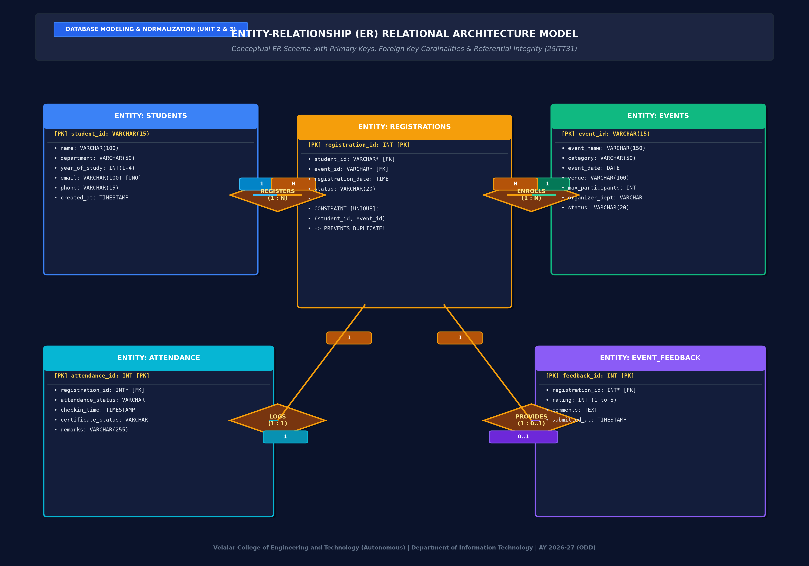
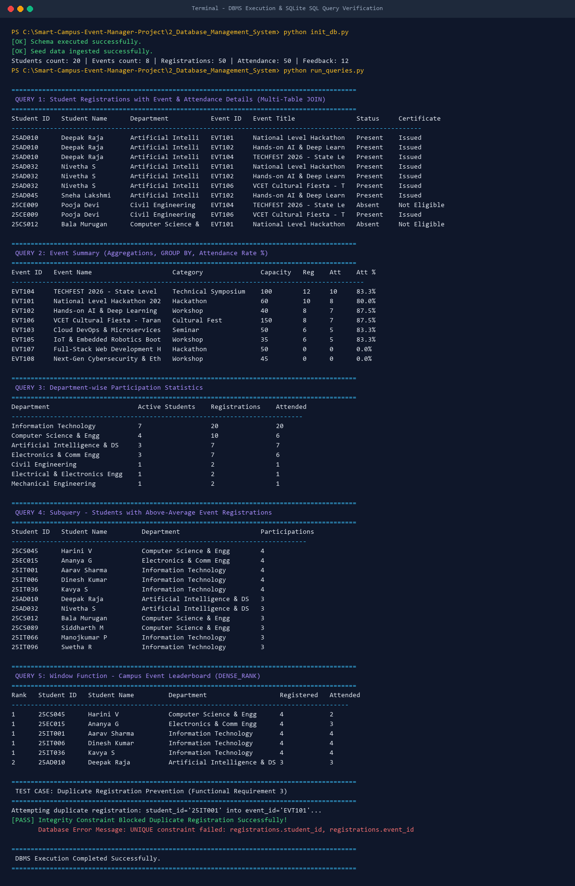

# VELALAR COLLEGE OF ENGINEERING AND TECHNOLOGY (AUTONOMOUS)
### (Approved by AICTE, New Delhi & Affiliated to Anna University, Chennai)
### Accredited by NAAC with 'A+' Grade | Accredited by NBA
### Thindal, Erode - 638 012, Tamil Nadu
---
## DEPARTMENT OF INFORMATION TECHNOLOGY
### ACADEMIC YEAR: 2026 - 2027 (ODD SEMESTER) | CLASS: 25IT3A&B
### COURSE: 25ITT31 - DATABASE MANAGEMENT SYSTEMS
### PROJECT-BASED ASSESSMENT (PBA) REPORT

---

# SCENARIO 6: SMART CAMPUS EVENT MANAGEMENT AND STUDENT PARTICIPATION ANALYSIS SYSTEM
**Assigned Register Numbers:** 25IT006, 25IT036, 25IT066, 25IT096

---

## 1. DATABASE DESIGN OVERVIEW

Manual handling of campus events, registrations, attendance, and certification often results in duplicate enrollments, inaccurate attendance metrics, and delays in administrative reporting. The database layer for the **Smart Campus Event Management and Student Participation Analysis System** provides a normalized, relational, ACID-compliant schema engineered using SQLite. It enforces strict referential integrity, automated timestamping, and uniqueness constraints to prevent duplicate student registrations at the database engine level.

---

## 2. ENTITY-RELATIONSHIP (ER) DIAGRAM

The system architecture models real-world academic event workflows across five principal entities: `STUDENTS`, `EVENTS`, `REGISTRATIONS`, `ATTENDANCE`, and `EVENT_FEEDBACK`.

### Key Cardinalities & Constraints:
1. **STUDENTS to REGISTRATIONS (1 : N)**: A student can register for zero, one, or multiple distinct campus events.
2. **EVENTS to REGISTRATIONS (1 : N)**: An event can accept registrations up to its defined maximum capacity (`max_participants`).
3. **Prevent Duplicate Registrations**: A composite unique constraint `CONSTRAINT unq_student_event UNIQUE (student_id, event_id)` prevents the same student from enrolling in the same event more than once.
4. **REGISTRATIONS to ATTENDANCE (1 : 1)**: Each event registration produces at most one official attendance log record with certificate eligibility.
5. **REGISTRATIONS to EVENT_FEEDBACK (1 : 0..1)**: Attending students can optionally submit 1-to-5 star ratings and reviews.

---

## 3. RELATIONAL DATA MODEL

The database schema is mapped into the following relational structure:

* **STUDENTS** ($\underline{\text{student\_id}}$, name, department, year\_of\_study, email, phone, created\_at)
  * **Primary Key:** `student_id`
  * **Candidate Key:** `email`

* **EVENTS** ($\underline{\text{event\_id}}$, event\_name, category, event\_date, venue, max\_participants, organizer\_dept, status)
  * **Primary Key:** `event_id`
  * **Domain Constraints:** `category IN ('Technical Symposium', 'Workshop', 'Hackathon', 'Seminar', 'Cultural Fest', 'Webinar')`, `status IN ('Upcoming', 'Ongoing', 'Completed', 'Cancelled')`

* **REGISTRATIONS** ($\underline{\text{registration\_id}}$, $\text{student\_id}^*$, $\text{event\_id}^*$, registration\_date, status)
  * **Primary Key:** `registration_id`
  * **Foreign Key 1:** `student_id` $\rightarrow$ `STUDENTS(student_id)` ON DELETE CASCADE
  * **Foreign Key 2:** `event_id` $\rightarrow$ `EVENTS(event_id)` ON DELETE CASCADE
  * **Integrity Constraint:** `UNIQUE(student_id, event_id)`

* **ATTENDANCE** ($\underline{\text{attendance\_id}}$, $\text{registration\_id}^*$, attendance\_status, checkin\_time, certificate\_status, remarks)
  * **Primary Key:** `attendance_id`
  * **Foreign Key:** `registration_id` $\rightarrow$ `REGISTRATIONS(registration_id)` ON DELETE CASCADE (UNIQUE)
  * **Domain Constraints:** `attendance_status IN ('Present', 'Absent')`, `certificate_status IN ('Pending', 'Issued', 'Not Eligible')`

* **EVENT_FEEDBACK** ($\underline{\text{feedback\_id}}$, $\text{registration\_id}^*$, rating, comments, submitted\_at)
  * **Primary Key:** `feedback_id`
  * **Foreign Key:** `registration_id` $\rightarrow$ `REGISTRATIONS(registration_id)` ON DELETE CASCADE (UNIQUE)
  * **Check Constraint:** `rating BETWEEN 1 AND 5`

---

## 4. DATABASE NORMALIZATION ANALYSIS

Normalization is systematically applied from Unnormalized Form (UNF) through First (1NF), Second (2NF), Third (3NF), and Boyce-Codd Normal Form (BCNF) to eliminate data redundancy and insertion/update/deletion anomalies.

### 4.1 Unnormalized Form (UNF)
In an unnormalized flat file:
$$\text{CAMPUS\_EVENT\_RECORD} = \{\text{student\_id}, \text{name}, \text{dept}, \text{year}, \text{email}, \text{phone}, \{\text{event\_id}, \text{event\_name}, \text{category}, \text{date}, \text{venue}, \text{max\_cap}, \text{reg\_date}, \text{att\_status}, \text{cert\_status}, \text{rating}\}\}$$
* **Issues:** Repeating groups of events per student, multi-valued attributes, significant storage redundancy, and vulnerability to anomalies.

### 4.2 First Normal Form (1NF)
* **Rule:** A relation is in 1NF if all attribute values are atomic (indivisible) and there are no repeating groups.
* **Transformation:** We expand multivalued event groups into separate tuples, uniquely identified by composite key $(\text{student\_id}, \text{event\_id})$.
* **Functional Dependencies (FDs):**
  * $FD_1: \text{student\_id} \rightarrow \text{name, department, year\_of\_study, email, phone}$
  * $FD_2: \text{event\_id} \rightarrow \text{event\_name, category, event\_date, venue, max\_participants, organizer\_dept}$
  * $FD_3: (\text{student\_id}, \text{event\_id}) \rightarrow \text{registration\_date, attendance\_status, checkin\_time, certificate\_status, rating}$

### 4.3 Second Normal Form (2NF)
* **Rule:** A relation is in 2NF if it is in 1NF and no non-prime attribute is partially dependent on any candidate key (elimination of partial dependencies).
* In 1NF, $(\text{student\_id}, \text{event\_id})$ is the composite candidate key.
  * $FD_1$ depends solely on part of the key ($\text{student\_id}$).
  * $FD_2$ depends solely on part of the key ($\text{event\_id}$).
* **Decomposition into 2NF:**
  1. `STUDENTS(student_id, name, department, year_of_study, email, phone)`
  2. `EVENTS(event_id, event_name, category, event_date, venue, max_participants, organizer_dept, status)`
  3. `REGISTRATIONS(registration_id, student_id, event_id, registration_date)`
  4. `ATTENDANCE(attendance_id, registration_id, attendance_status, checkin_time, certificate_status, remarks)`
  5. `EVENT_FEEDBACK(feedback_id, registration_id, rating, comments)`

### 4.4 Third Normal Form (3NF)
* **Rule:** A relation is in 3NF if it is in 2NF and there are no transitive dependencies ($X \rightarrow Y$ and $Y \rightarrow Z$).
* In our 2NF relations:
  * In `STUDENTS`, all non-prime attributes depend only on the primary key `student_id`. No transitive dependency exists.
  * In `EVENTS`, `event_id` directly determines venue, date, and category.
  * In `REGISTRATIONS`, `registration_id` determines student, event, and timestamp.
  * In `ATTENDANCE`, `attendance_id` determines attendance and certificate status.
* Therefore, the schema satisfies **3NF**.

### 4.5 Boyce-Codd Normal Form (BCNF)
* **Rule:** A relation is in BCNF if for every non-trivial functional dependency $X \rightarrow Y$, $X$ is a superkey.
* In all five relations:
  * In `STUDENTS`: Determinants are `student_id` (PK) and `email` (Candidate Key) $\rightarrow$ both are superkeys.
  * In `EVENTS`: Determinant is `event_id` (PK) $\rightarrow$ superkey.
  * In `REGISTRATIONS`: Determinants are `registration_id` (PK) and `(student_id, event_id)` (Candidate Key) $\rightarrow$ both are superkeys.
  * In `ATTENDANCE`: Determinants are `attendance_id` (PK) and `registration_id` (Candidate Key) $\rightarrow$ superkeys.
  * In `EVENT_FEEDBACK`: Determinants are `feedback_id` (PK) and `registration_id` (Candidate Key) $\rightarrow$ superkeys.
* The relational database is strictly in **BCNF**, completely free of update, deletion, and insertion anomalies.

---

## 5. SQL QUERY IMPLEMENTATION & EXPERIMENTAL RESULTS

The database was populated with 20 student profiles from all VCET engineering departments, 8 college events across diverse categories, 50 registrations, and attendance/feedback logs.

### Execution Screenshot (SQLite Database Engine)
The following terminal screenshot verifies database initialization, foreign key enforcement, multi-table joins, aggregations, window ranking, and duplicate registration blocking:

### Summary of Executed Queries:
1. **Multi-Table Inner & Left JOINs:** Combined students, registrations, events, and attendance statuses into comprehensive academic rosters.
2. **Aggregations & GROUP BY with HAVING:** Computed event-wise registration volume, attendance rates (%), and participation yields.
3. **Nested & Correlated Subqueries:** Identified active high-performing students who exceeded the college average participation benchmark.
4. **Window Functions (`DENSE_RANK()`):** Formulated institutional leaderboards based on event participation counts.
5. **Duplicate Registration Integrity Test:** Confirmed that attempting duplicate registration (`student_id='25IT001'` in `event_id='EVT101'`) triggers an immediate `UNIQUE constraint failed` exception, satisfying Functional Requirement 3.

---

## 6. VERIFICATION FILES
* [schema.sql](schema.sql): Complete DDL tables, check constraints, views, and indexes.
* [seed_data.sql](seed_data.sql): Realistic sample datasets representing VCET events.
* [queries.sql](queries.sql): Comprehensive SQL queries aligned with Anna University/VCET DBMS syllabus.
* [init_db.py](init_db.py): Automated database builder script.
* [run_queries.py](run_queries.py): Automated SQL test and verification script.
