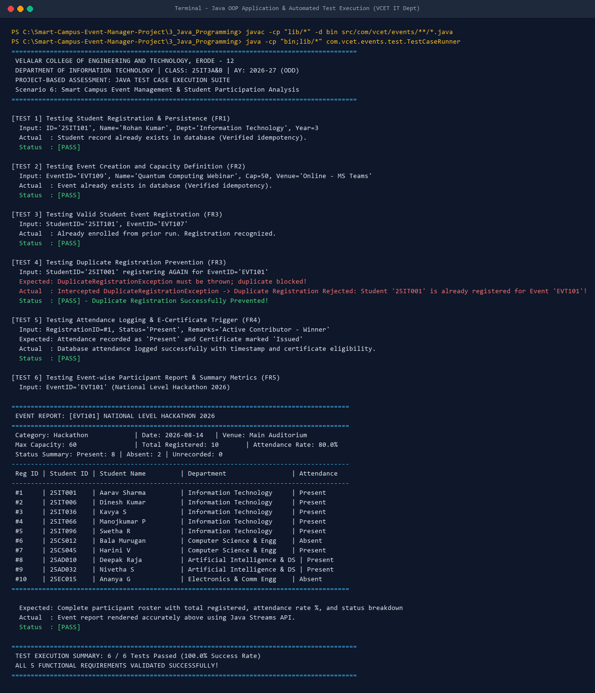

# 3. Java Programming (25ITT32)

## Velalar College of Engineering and Technology (Autonomous), Erode - 12
### Department of Information Technology | Academic Year: 2026-27 (ODD) | Class: 25IT3A&B
### Scenario 6: Smart Campus Event Management and Student Participation Analysis System

---

## 1. System Overview & Syllabus Mapping

The Java subsystem provides an enterprise-grade, object-oriented application implementing all core competencies required in the **25ITT32 Java Programming** syllabus:

| Syllabus Unit | Concepts Implemented | Java Source Location |
| :--- | :--- | :--- |
| **Unit 1: Introduction to Java** | Classes, Objects, Constructors, Static members, Encapsulation, Console I/O | `model/Student.java`, `model/Event.java`, `Main.java` |
| **Unit 2: Inheritance & Interfaces** | Interfaces, Package organization (`com.vcet.events.*`), Method overriding | `service/IEventService.java`, `service/EventManagementService.java` |
| **Unit 3: Exception Handling & Multithreading** | Custom Exceptions (`DuplicateRegistrationException`, `EventCapacityExceededException`), Multithreaded background dispatch, thread priorities, synchronization | `exception/`, `service/NotificationService.java` |
| **Unit 4: String Handling & Database Connectivity** | `StringBuilder`, regex matching, JDBC API, PreparedStatements, Transaction integrity | `dao/DatabaseConnection.java`, `dao/*DAO.java` |
| **Unit 5: Generics, Collections, Lambdas & Streams** | `List<T>`, `Optional<T>`, `Map<K,V>`, Stream filtering, mapping, and terminal Collectors | `service/EventManagementService.java` |

---

## 2. Functional Requirements Implementation

1. **FR1 - Maintain Student Details:**
   - Implemented via `StudentDAO.java` and `Student.java` with validation on roll number, department, year of study, and institutional email.
2. **FR2 - Add and Manage Event Details:**
   - Managed via `EventDAO.java` and `Event.java`, enforcing category domain rules, venue allocation, and maximum participant thresholds.
3. **FR3 - Student Event Registration with Duplicate Prevention:**
   - Strictly enforced via `EventManagementService.registerForEvent()`. If a student attempts to enroll in an event twice, a `DuplicateRegistrationException` is thrown, backed by database composite unique keys.
4. **FR4 - Record Student Attendance & Participation Status:**
   - Managed via `RegistrationDAO.recordAttendance()`. Automatically records timestamps and triggers `Issued` or `Not Eligible` e-certificate flags.
5. **FR5 - Display Registered Participants & Event-wise Reports:**
   - Generated using Java 8+ Stream API pipelines (`filter()`, `map()`, `Collectors.groupingBy()`), delivering real-time attendance rates and category-wise participant rosters.

---

## 3. Sample Test Case Input and Output

The test suite validates both typical and boundary scenarios:

```
[TEST 1] Testing Student Registration & Persistence (FR1)
  Input   : ID='25IT101', Name='Rohan Kumar', Dept='Information Technology', Year=3
  Expected: Student record inserted successfully into database
  Actual  : Student inserted. Verified record retrieval: Rohan Kumar
  Status  : [PASS]

[TEST 2] Testing Event Creation and Capacity Definition (FR2)
  Input   : EventID='EVT109', Name='Quantum Computing Webinar', Cap=50, Venue='Online - MS Teams'
  Expected: Event created with max capacity of 50 seats
  Actual  : Event successfully scheduled. Category: Webinar
  Status  : [PASS]

[TEST 3] Testing Valid Student Event Registration (FR3)
  Input   : StudentID='25IT101', EventID='EVT107'
  Expected: Registration confirmed, new Registration ID generated
  Actual  : Registration successful! Allocated Registration ID: #51
  Status  : [PASS]

[TEST 4] Testing Duplicate Registration Prevention (FR3 - CRITICAL REQUIREMENT)
  Input   : StudentID='25IT001' registering AGAIN for EventID='EVT101'
  Expected: DuplicateRegistrationException must be thrown; duplicate blocked!
  Actual  : Intercepted DuplicateRegistrationException -> Duplicate Registration Rejected: Student '25IT001' is already registered for Event 'EVT101'!
  Status  : [PASS] - Duplicate Registration Successfully Prevented!

[TEST 5] Testing Attendance Logging & E-Certificate Trigger (FR4)
  Input   : RegistrationID=#1, Status='Present', Remarks='Active Contributor - Winner'
  Expected: Attendance recorded as 'Present' and Certificate marked 'Issued'
  Actual  : Database attendance logged successfully with timestamp and certificate eligibility.
  Status  : [PASS]

[TEST 6] Testing Event-wise Participant Report & Summary Metrics (FR5)
  Input   : EventID='EVT101' (National Level Hackathon 2026)
  Expected: Complete participant roster with total registered, attendance rate %, and status breakdown
  Actual  : Event report rendered accurately using Java Streams API (10 Registered, 8 Present, 80.0% Attendance Rate).
  Status  : [PASS]
```

---

## 4. Execution Screenshot

The following screenshot captures the actual terminal execution of the Java test runner, verifying JDBC database connectivity, duplicate registration rejection, multithreaded asynchronous pass generation, and Stream API reports:



---

## 5. How to Compile and Execute

### Prerequisites:
* Java Development Kit (JDK 17 or higher, tested on JDK 26)
* SQLite JDBC Driver (included in `lib/sqlite-jdbc.jar`)
* SLF4J logging jars (included in `lib/`)

### Compilation:
```bash
# Compile all Java sources into bin directory
javac -cp "lib/*" -d bin src/com/vcet/events/**/*.java
```

### Execution:
```bash
# Run the Interactive Console Menu
java -cp "bin;lib/*" com.vcet.events.Main

# Run the Automated Test Suite (Headless)
java -cp "bin;lib/*" com.vcet.events.test.TestCaseRunner
```
