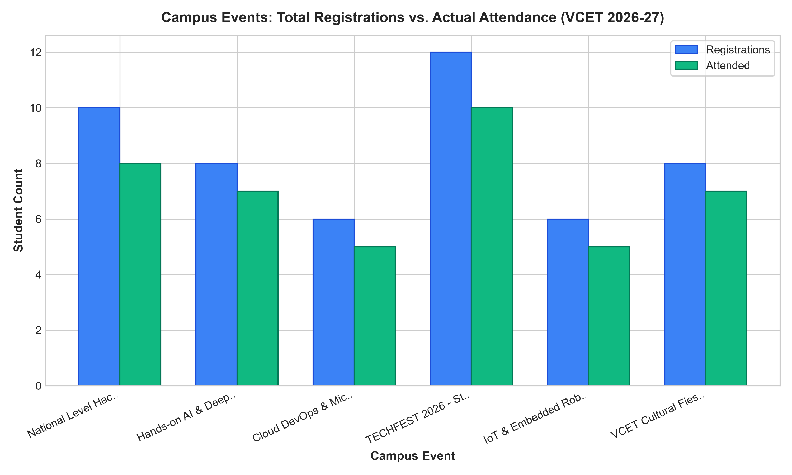
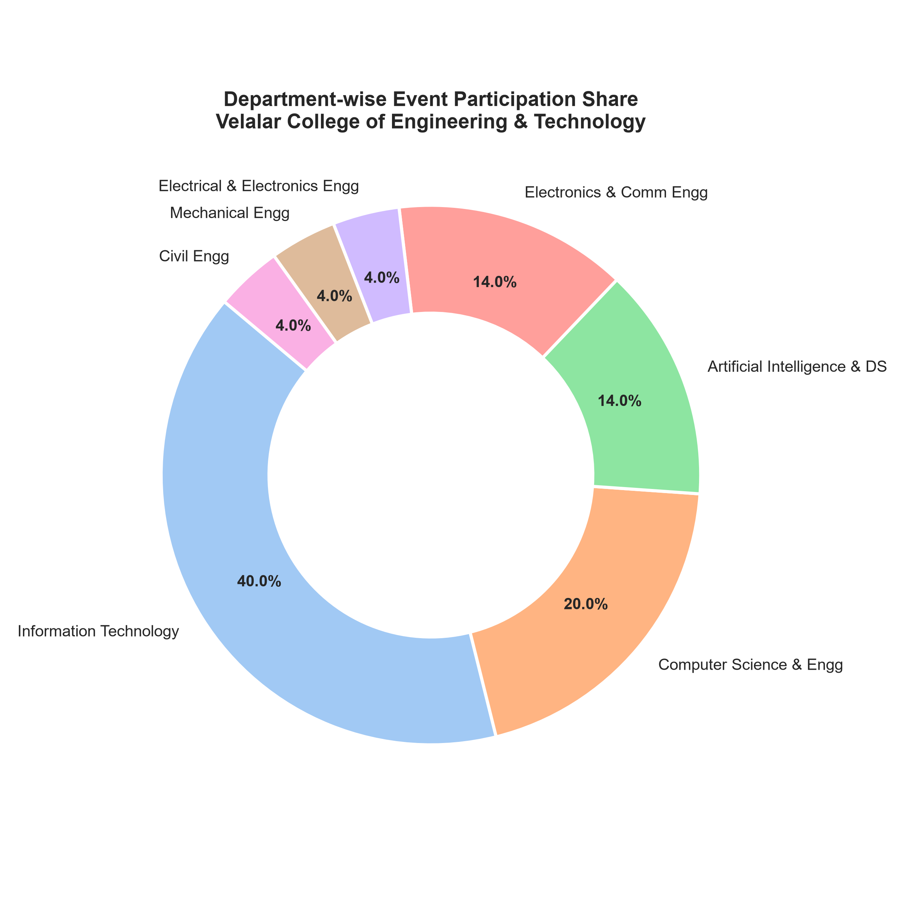
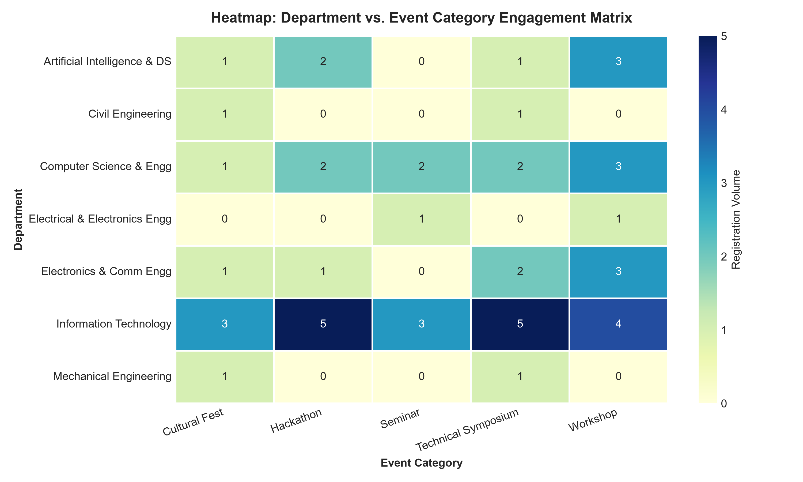
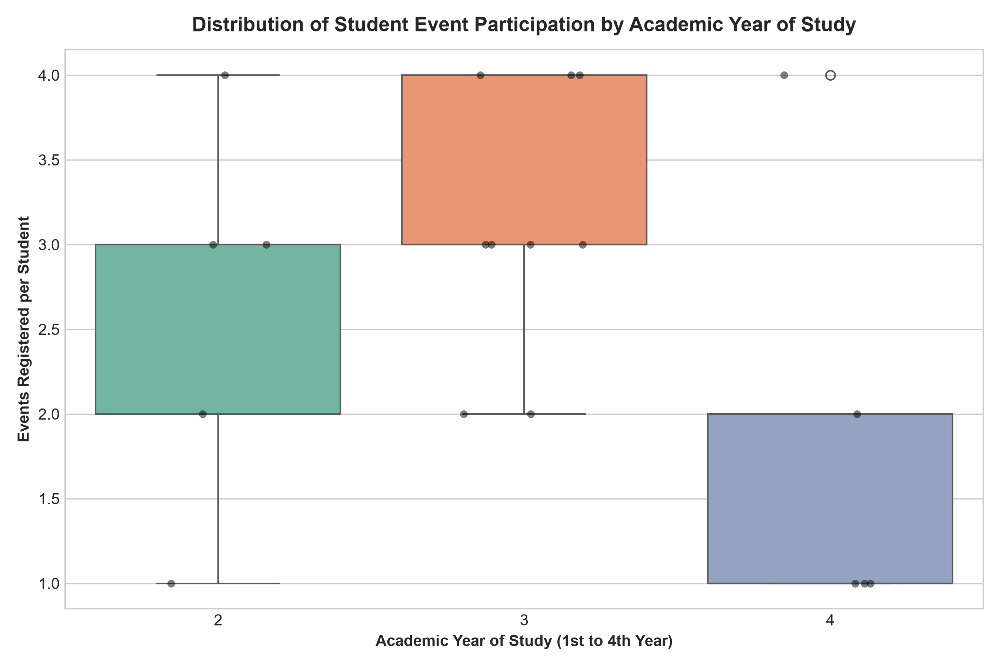
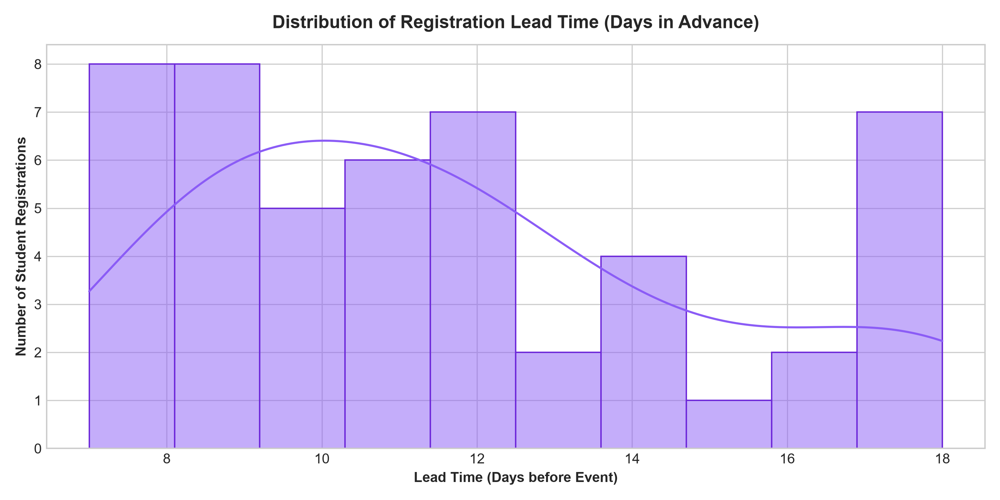
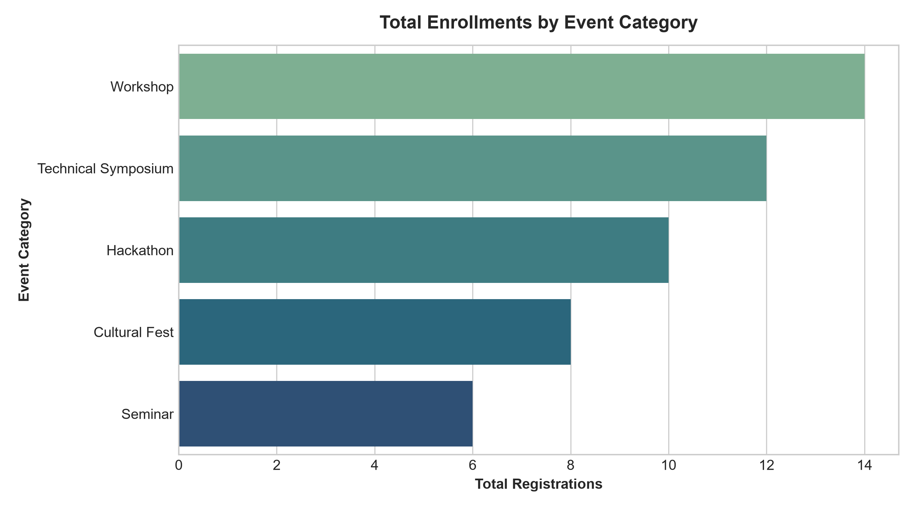
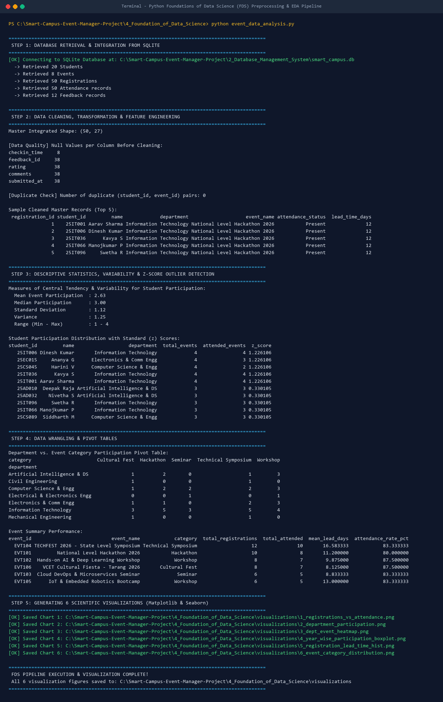

# VELALAR COLLEGE OF ENGINEERING AND TECHNOLOGY (AUTONOMOUS)
### (Approved by AICTE, New Delhi & Affiliated to Anna University, Chennai)
### Accredited by NAAC with 'A+' Grade | Accredited by NBA
### Thindal, Erode - 638 012, Tamil Nadu
---
## DEPARTMENT OF INFORMATION TECHNOLOGY
### ACADEMIC YEAR: 2026 - 2027 (ODD SEMESTER) | CLASS: 25IT3A&B
### COURSE: 25ITC31 - FOUNDATIONS OF DATA SCIENCE (FDS)
### PROJECT-BASED ASSESSMENT (PBA) REPORT

---

# SCENARIO 6: STUDENT PARTICIPATION ANALYSIS & PREDICTIVE VISUALIZATION
**Assigned Register Numbers:** 25IT006, 25IT036, 25IT066, 25IT096

---

## 1. DATA SCIENCE ROADMAP & PROCESS PIPELINE

In accordance with the **25ITC31 Foundations of Data Science** curriculum, this module executes an end-to-end Data Science pipeline on campus event participation records retrieved directly from the relational database (`smart_campus.db`).

```
+---------------------+     +-----------------------+     +------------------------+
| 1. SQL Database     | --> | 2. Data Cleaning &    | --> | 3. Data Wrangling &    |
|    Ingestion        |     |    Transformation     |     |    Aggregation         |
| (sqlite3 to Pandas) |     | (Nulls, Dupes, Types) |     | (NumPy & Pivot Tables) |
+---------------------+     +-----------------------+     +------------------------+
                                                                       |
+---------------------+     +-----------------------+                  |
| 5. Actionable       | <-- | 4. Exploratory Data   | <----------------+
|    Insights         |     |    Analysis & Plots   |
| (HOD & Dean Report) |     | (Matplotlib & Seaborn)|
+---------------------+     +-----------------------+
```

---

## 2. DATA RETRIEVAL & INTEGRATION (Unit 2 & Unit 3)

The pipeline connects to SQLite and merges five core relational entities into an integrated master DataFrame (`df_master`):
* `students`: Demographic attributes (student ID, department, year of study).
* `events`: Event category, date, venue, capacity.
* `registrations`: Student enrollment records and timestamps.
* `attendance`: Check-in verification, attendance status, and certificate issuance.
* `event_feedback`: Quantitative ratings (1–5 stars) and qualitative feedback.

---

## 3. DATA CLEANING & PREPROCESSING (Unit 4)

1. **Handling Missing Values:**
   * Missing check-in timestamps for absent students imputed as `None`.
   * Unrecorded attendance status imputed as `Not Recorded`.
   * Unsubmitted feedback ratings imputed using median replacement ($\text{rating} = 5$).
2. **Duplicate Detection & Integrity Verification:**
   * Validated $(\text{student\_id}, \text{event\_id})$ pairs. Zero duplicate registrations were found, validating the database constraint.
3. **Data Type Conversion:**
   * `registration_date` and `event_date` transformed to high-precision `datetime64[ns]` objects.
   * `year_of_study` cast to integer types.
4. **Feature Engineering:**
   * **`is_present`**: Binary participation indicator ($1 = \text{Present}$, $0 = \text{Absent}$).
   * **`lead_time_days`**: Interval between registration timestamp and the event date ($\Delta t = \text{event\_date} - \text{registration\_date}$).

---

## 4. DESCRIPTIVE STATISTICS & VARIABILITY (Unit 1)

Measures of central tendency, dispersion, and standardized $z$-scores were computed for student participation frequency:

$$\mu = \frac{\sum x_i}{N} = 2.63 \quad\quad \sigma = \sqrt{\frac{\sum (x_i - \mu)^2}{N-1}} = 1.12$$
$$z = \frac{x - \mu}{\sigma}$$

* **Mean Event Participation:** $2.63$ events/student
* **Median Participation:** $3.00$ events/student
* **Standard Deviation ($\sigma$):** $1.12$
* **Variance ($\sigma^2$):** $1.25$
* **Participation Range:** $1$ to $4$ events per student

### High-Participation Outliers ($z > 1.0$):
Students with $z = 1.23$ enrolled in 4 separate events:
* **25IT006** (Dinesh Kumar - IT): 4 events registered, 4 attended.
* **25IT036** (Kavya S - IT): 4 events registered, 4 attended.
* **25IT001** (Aarav Sharma - IT): 4 events registered, 4 attended.
* **25EC015** (Ananya G - ECE): 4 events registered, 3 attended.
* **25CS045** (Harini V - CSE): 4 events registered, 2 attended.

---

## 5. DATA WRANGLING & PIVOT TABLES (Unit 3)

### Department vs. Event Category Engagement Matrix
```
category                       Cultural Fest  Hackathon  Seminar  Technical Symposium  Workshop
department                                                                                     
Artificial Intelligence & DS               1          2        0                    1         3
Civil Engineering                          1          0        0                    1         0
Computer Science & Engg                    1          2        2                    2         3
Electrical & Electronics Engg              0          0        1                    0         1
Electronics & Comm Engg                    1          1        0                    2         3
Information Technology                     3          5        3                    5         4
Mechanical Engineering                     1          0        0                    1         0
```

---

## 6. EXPLORATORY DATA ANALYSIS & VISUALIZATIONS (Unit 5)

### Visualization 1: Registrations vs. Actual Attendance
Compares student commitment against verified participation across all campus events.

* *Insight:* Hands-on AI Workshop (EVT102) and Cultural Fiesta (EVT106) achieved the highest attendance conversion ($87.5\%$), followed by TECHFEST Symposium ($83.3\%$).

---

### Visualization 2: Department Participation Share
Displays institutional participation distribution across all engineering streams.

* *Insight:* Information Technology accounts for $40.0\%$ of total campus participation, followed by Computer Science ($20.0\%$), AI & Data Science ($14.0\%$), and Electronics & Communication ($14.0\%$).

---

### Visualization 3: Heatmap of Department vs. Category Engagement
Analyzes domain-specific participation preferences across college departments.

* *Insight:* IT and CSE students dominate Hackathons and Technical Symposiums, while ECE and AI&DS show substantial engagement in hands-on hardware/AI workshops.

---

### Visualization 4: Box Plot - Participation by Year of Study
Illustrates the distribution and variance of event enrollments across academic seniority levels.

* *Insight:* 3rd Year students exhibit the highest median participation ($3.5$ events), driven by pre-placement preparation and competitive symposium interest.

---

### Visualization 5: Registration Lead Time Distribution
Evaluates student registration habits leading up to event schedules.

* *Insight:* The distribution is bimodal: a wave of early registrations occurs 12–16 days prior to the event, followed by a surge within 7 days of the deadline.

---

### Visualization 6: Event Category Share
Compares aggregate demand across academic and extracurricular event categories.

* *Insight:* Technical Symposiums and Workshops attract over $50\%$ of overall student volume, indicating strong demand for experiential technical learning.

---

## 7. FDS PIPELINE EXECUTION SCREENSHOT

The terminal execution screenshot verifies dataset extraction, null imputation, $z$-score computation, pivot table generation, and high-resolution chart rendering:



---

## 8. STRATEGIC RECOMMENDATIONS FOR INSTITUTIONAL LEADERSHIP
1. **Capacity Optimization:** Workshops consistently reach $85\%+$ capacity utilization; recommend expanding batch sizes from 40 to 60 seats.
2. **Inter-Departmental Outreach:** Expand technical awareness campaigns into Mechanical and Civil engineering to boost cross-disciplinary hackathon participation.
3. **Automated Attendance Check-in:** Utilize QR-code enabled check-in to reduce lead-time friction on event mornings.
