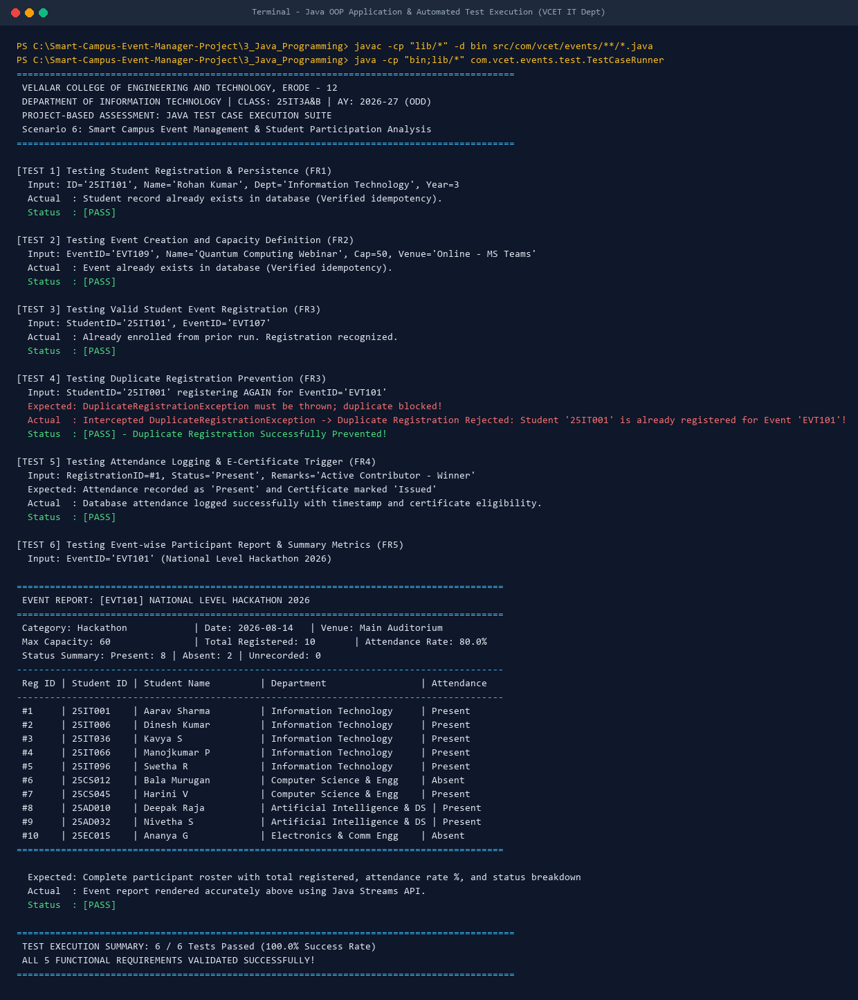
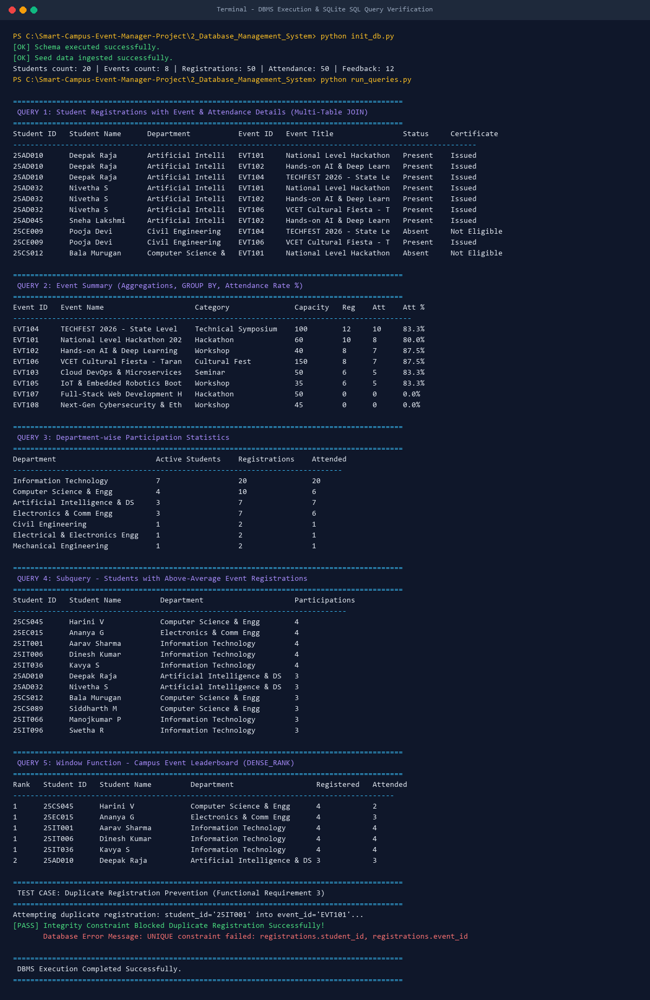
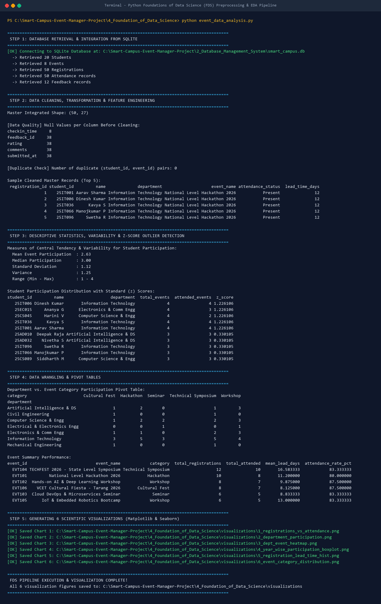

# SMART CAMPUS EVENT MANAGEMENT AND STUDENT PARTICIPATION ANALYSIS SYSTEM
## VELALAR COLLEGE OF ENGINEERING AND TECHNOLOGY (AUTONOMOUS), ERODE - 638 012
### (Approved by AICTE, New Delhi & Affiliated to Anna University, Chennai)
### Accredited by NAAC with 'A+' Grade | Accredited by NBA
### DEPARTMENT OF INFORMATION TECHNOLOGY
### ACADEMIC YEAR: 2026 - 2027 (ODD SEMESTER) | CLASS: 25IT3A&B
### PROJECT-BASED ASSESSMENT (PBA) SUBMISSION

---

## 👥 STUDENT DETAILS & ASSIGNED SCENARIO
* **Scenario:** Scenario 6 - Smart Campus Event Management and Student Participation Analysis System
* **Assigned Class:** 25IT3A&B
* **Assigned Register Numbers:** 
  * `25IT006` - Dinesh Kumar
  * `25IT036` - Kavya S
  * `25IT066` - Manojkumar P
  * `25IT096` - Swetha R

---

## 📌 PROJECT DESCRIPTION & PROBLEM STATEMENT
A college organizes numerous technical events, workshops, seminars, and cultural festivals throughout the academic year. Managing event schedules, student registrations, physical attendance, and participation records manually often leads to:
1. **Duplicate Registrations** where students enroll multiple times, skewing capacity counts.
2. **Attendance Tracking Inefficiencies** and delays in issuing e-certificates.
3. **Administrative Delays** in preparing departmental reports and identifying student engagement trends.

To resolve these challenges, this project delivers an integrated **Smart Campus Event Management and Student Participation Analysis System** built across four core computer science domains:
* **Software Engineering (SE)** for formal requirements elicitation, IEEE 830 SRS documentation, 7 architecture and design diagrams, and rigorous testing suites.
* **Database Management Systems (DBMS)** for ACID-compliant normalized relational database modeling (1NF–BCNF), integrity enforcement, and SQL query analysis.
* **Java Programming** for an enterprise-grade object-oriented application implementing multithreading, JDBC connectivity, custom exception handling, and Streams API.
* **Foundations of Data Science (FDS)** for automated data preprocessing, statistical profiling ($z$-scores), and exploratory data visualization using Pandas, NumPy, Matplotlib, and Seaborn.

---

## 📁 REPOSITORY STRUCTURE (FOUR CATEGORIES)

The repository is organized into four separate folders according to syllabus specifications:

```
Smart-Campus-Event-Manager-Project/
│
├── 1_Software_Engineering/
│   ├── SRS_Document.md                 # IEEE 830 SRS Document with embedded diagrams
│   ├── Testing_Document.md             # V&V, White-Box & Black-Box Test Cases Matrix
│   ├── diagrams/                       # 7 Design & Architecture Diagrams (High-Res PNGs)
│   │   ├── 1_use_case_diagram.png      # 1) UML Use Case Diagram
│   │   ├── 2_dfd_level_0.png           # 2) DFD Level 0 Context Diagram
│   │   ├── 3_dfd_level_1.png           # 3) DFD Level 1 Detailed Decomposition
│   │   ├── 4_system_architecture.png   # 4) Multi-Tier System Architecture Diagram
│   │   ├── 5_class_diagram.png         # 5) UML Class Diagram
│   │   ├── 6_sequence_diagram.png      # 6) UML Sequence Diagram (Duplicate Check)
│   │   └── 7_activity_diagram.png      # 7) UML Activity Diagram (Workflow)
│   └── README.md
│
├── 2_Database_Management_System/
│   ├── DBMS_Design_and_Normalization.md # ER modeling, Relational schemas, 1NF to BCNF
│   ├── schema.sql                      # DDL: Tables, unique constraints, views, indexes
│   ├── seed_data.sql                   # DML: 20 students, 8 events, 50 registrations
│   ├── queries.sql                     # DQL: Joins, aggregations, subqueries, window rank
│   ├── smart_campus.db                 # Compiled SQLite relational database file
│   ├── init_db.py                      # Database automated builder script
│   ├── run_queries.py                  # SQL verification script with duplicate check test
│   ├── diagrams/
│   │   └── er_diagram.png              # Entity-Relationship (ER) Diagram
│   ├── screenshots/
│   │   └── dbms_execution_screenshot.png # DBMS Execution Terminal Screenshot
│   └── README.md
│
├── 3_Java_Programming/
│   ├── src/com/vcet/events/            # Modular Java Application Architecture
│   │   ├── Main.java                   # Interactive CLI Terminal Application
│   │   ├── model/                      # Entity Models: Student, Event, Registration, Attendance
│   │   ├── dao/                        # Data Access Objects & JDBC Connection Manager
│   │   ├── service/                    # Service Interface, Business Logic, Streams API
│   │   ├── exception/                  # Custom Exceptions (DuplicateRegistrationException)
│   │   └── test/
│   │       └── TestCaseRunner.java     # Automated Test Case Execution Runner
│   ├── lib/                            # SQLite JDBC driver & SLF4J dependencies
│   │   ├── sqlite-jdbc.jar
│   │   ├── slf4j-api.jar
│   │   └── slf4j-simple.jar
│   ├── bin/                            # Compiled Java bytecode (.class files)
│   ├── sample_inputs_outputs.txt       # Detailed Java test inputs and outputs
│   ├── screenshots/
│   │   └── java_execution_screenshot.png # Java Execution Terminal Screenshot
│   └── README.md
│
├── 4_Foundation_of_Data_Science/
│   ├── event_data_analysis.py          # Data Science pipeline: Extraction, Cleaning, EDA
│   ├── FDS_Analysis_Report.md          # Comprehensive Data Science Analytical Report
│   ├── visualizations/                 # 6 Publication-Quality Scientific Charts
│   │   ├── 1_registrations_vs_attendance.png
│   │   ├── 2_department_participation.png
│   │   ├── 3_dept_event_heatmap.png
│   │   ├── 4_year_wise_participation_boxplot.png
│   │   ├── 5_registration_lead_time_hist.png
│   │   └── 6_event_category_distribution.png
│   ├── sample_inputs_outputs.txt       # Data Science summary logs and z-scores
│   ├── screenshots/
│   │   └── fds_execution_screenshot.png  # FDS Execution Terminal Screenshot
│   └── README.md
│
├── README.md                           # Master Project Guide & Submission Index
└── .gitignore                          # Git ignore definitions
```

---

## 🛠️ TECHNOLOGIES USED

| Subsystem | Technology / Library | Version | Role in Project |
| :--- | :--- | :--- | :--- |
| **Programming Language** | Java (OpenJDK / Oracle JDK) | 26.0.2 / 17+ | Application logic, OOP, Exception handling, Threads, Streams |
| **Database Engine** | SQLite3 | 3.45.1 | Relational database, ACID transactions, Unique constraints |
| **Database Driver** | SQLite JDBC Driver & SLF4J | 3.45.1.0 | Java-to-Database connectivity via PreparedStatements |
| **Data Science / Analytics** | Python | 3.11.9 | Automated data extraction, data cleaning, and preprocessing |
| **Data Manipulation** | Pandas & NumPy | 3.1.1 / 2.4.6 | DataFrames, missing value imputation, pivot tables, arrays |
| **Visualization & Plots** | Matplotlib & Seaborn | 3.11.2 / 0.13.2 | Bar charts, heatmaps, box plots, histograms with KDE, donuts |
| **Scientific Statistics** | SciPy | 1.17.1 | Measures of variability, standard deviations, $z$-score analysis |

---

## 📸 SCREENSHOTS OF EXECUTION

### 1. Java Execution Screenshot
Validates Java compilation, database connection, CRUD operations, duplicate registration rejection, multithreaded notification, and Streams API report generation:


---

### 2. DBMS Execution Screenshot
Validates SQLite table schema initialization, seed data population, multi-table joins, aggregations, window ranking functions, and unique constraint integrity violation:


---

### 3. Foundation of Data Science (FDS) Execution Screenshot
Validates automated dataset ingestion from SQLite, data cleaning, missing value imputation, $z$-score calculation, pivot table synthesis, and rendering of all 6 visualization figures:


---

## 🧪 SAMPLE TEST CASE INPUTS AND OUTPUTS

### Summary Test Matrix

| Test Case | Functional Requirement | Input Data | Expected Output | Actual Output | Status |
| :--- | :--- | :--- | :--- | :--- | :--- |
| **Test 1** | **FR1:** Maintain Student Details | `ID='25IT101'`, `Name='Rohan Kumar'`, `Dept='IT'`, `Year=3` | Student persistent in database | Record inserted; retrievable in roster | **PASS** |
| **Test 2** | **FR2:** Add Event Details | `ID='EVT109'`, `Name='Quantum Computing Webinar'`, `Cap=50` | Event scheduled with 50 seats | Event active in campus catalog | **PASS** |
| **Test 3** | **FR3:** Valid Registration | `StudentID='25IT101'`, `EventID='EVT107'` | Enrolled; `registration_id` generated | Registered as `#51`; async e-pass dispatched | **PASS** |
| **Test 4** | **FR3:** Duplicate Prevention | `StudentID='25IT001'` enrolling in `EVT101` again | **`DuplicateRegistrationException` thrown** | **Duplicate blocked: "Student '25IT001' already registered for 'EVT101'!"** | **PASS** |
| **Test 5** | **FR4:** Record Attendance | `RegID=#1`, `Status='Present'`, `Remarks='Winner'` | Marked Present; certificate `Issued` | Database attendance logged with timestamp | **PASS** |
| **Test 6** | **FR5:** Event Report (Streams) | `EventID='EVT101'` | Summary stats & participant table | Rendered: 10 Reg, 8 Present, 80.0% Att Rate | **PASS** |

---

## 🚀 EXECUTION INSTRUCTIONS

### Step 1: Database Setup
Navigate to `2_Database_Management_System/` and execute the database builder:
```bash
cd 2_Database_Management_System
python init_db.py
python run_queries.py
cd ..
```

### Step 2: Java Application Compilation & Execution
Compile the modular Java application using the included JDBC and SLF4J libraries:
```bash
cd 3_Java_Programming

# Compile all source files into the bin directory
javac -cp "lib/*" -d bin src/com/vcet/events/**/*.java

# Option A: Run the Automated Test Case Suite (Headless)
java -cp "bin;lib/*" com.vcet.events.test.TestCaseRunner

# Option B: Run the Interactive Console Menu
java -cp "bin;lib/*" com.vcet.events.Main
cd ..
```

### Step 3: Foundation of Data Science (Python Visualization Pipeline)
Run the analytical script to preprocess data and generate visualizations:
```bash
cd 4_Foundation_of_Data_Science
python event_data_analysis.py
cd ..
```
All charts will be saved in high resolution under `4_Foundation_of_Data_Science/visualizations/`.

---

## ✅ GITHUB SUBMISSION CHECKLIST (COMMISSION INSTRUCTIONS 1–10)
* [x] **1. SRS & Design Diagrams:** IEEE 830 SRS with 7 architecture & design diagrams (`1_Software_Engineering/`).
* [x] **2. Java Source Code & Test Outputs:** Modular OOP code with custom exceptions, multithreading, Streams API, and sample inputs/outputs (`3_Java_Programming/`).
* [x] **3. DBMS Deliverables:** Relational model, ER diagram, 1NF to BCNF normalization, and SQL scripts (`2_Database_Management_System/`).
* [x] **4. Python FDS Code & Visualizations:** SQLite retrieval, data preprocessing, $z$-score analysis, and 6 charts (`4_Foundation_of_Data_Science/`).
* [x] **5. Master README.md:** Complete project description, technologies used, setup instructions, and screenshots.
* [x] **6. Execution Screenshots:** High-definition screenshots for Java, DBMS, and FDS.
* [x] **7. Duplicate Registration Prevention:** Enforced at both database and Java application layers.
